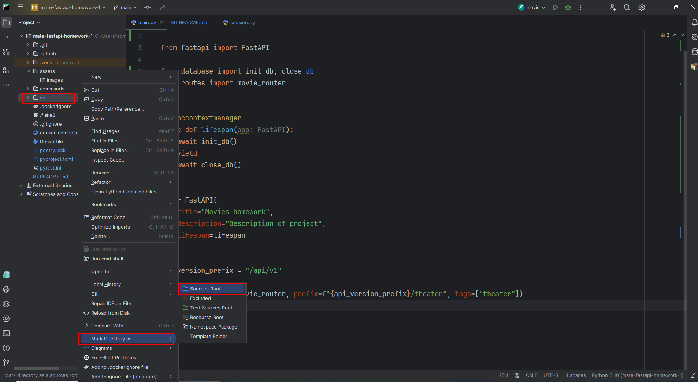
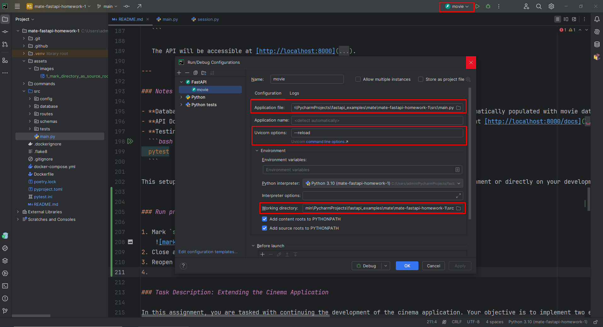
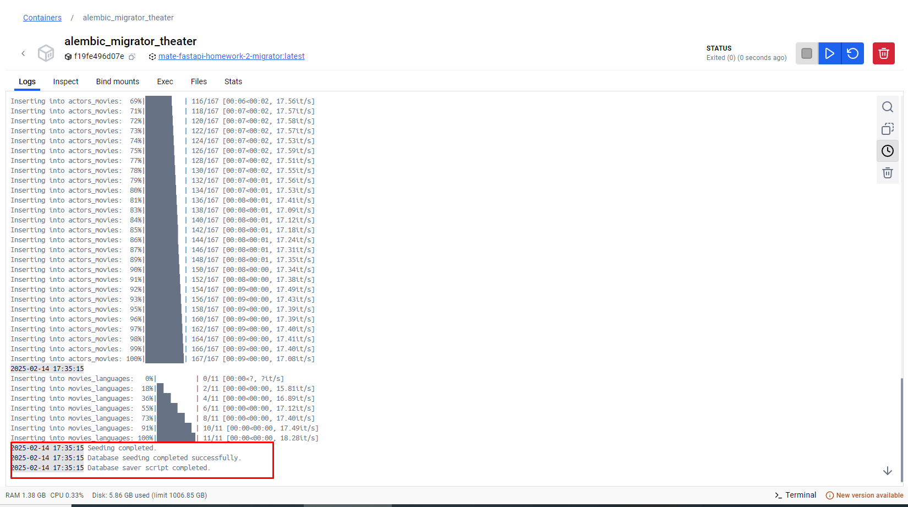

# Проєкт Movie Theater API

## Зміст

- [Огляд проєкту](#огляд-структури-проєкту)
- [Огляд структури проєкту](#огляд-структури-проєкту)
  - [Кореневий каталог](#кореневий-каталог)
  - [Команди](#команди)
  - [Вихідний каталог (`src`)](#вихідний-каталог-src)
  - [Порада: використання `get_db` для впровадження залежностей у FastAPI](#порада-використання-get_db-для-впровадження-залежностей-у-fastapi)
- [Огляд сервісів](#огляд-сервісів)
  - [Сервіс бази даних](#1-сервіс-бази-даних-db)
  - [Сервіс pgAdmin](#2-сервіс-pgadmin-pgadmin)
  - [Бекенд-сервіс](#3-бекенд-сервіс-web)
  - [Сервіс міграцій бази даних](#4-сервіс-міграцій-бази-даних-migrator)
- [Томи](#томи)
- [Мережі](#мережі)
- [Як запустити проєкт](#як-запустити-проєкт)
- [Запуск проєкту в PyCharm](#запуск-проєкту-в-pycharm)
- [Огляд моделей та сутностей](#огляд-моделей-та-сутностей)
  - [Моделі акаунтів](#моделі-акаунтів)
    - [UserGroupModel](#1-usergroupmodel)
    - [UserModel](#2-usermodel)
    - [UserProfileModel](#3-userprofilemodel)
    - [TokenBaseModel](#4-tokenbasemodel)
    - [ActivationTokenModel](#5-activationtokenmodel)
    - [PasswordResetTokenModel](#6-passwordresettokenmodel)
    - [RefreshTokenModel](#7-refreshtokenmodel)
  - [Моделі фільмів](#моделі-фільмів)
    - [MovieModel](#1-moviemodel)
    - [GenreModel](#2-genremodel)
    - [ActorModel](#3-actormodel)
    - [CountryModel](#4-countrymodel)
    - [LanguageModel](#5-languagemodel)
    - [Асоціативні таблиці](#6-асоціативні-таблиці)
- [Опис завдання: розширення застосунку кінотеатру](#опис-завдання-розширення-застосунку-кінотеатру)
  - [Реалізувати ендпоїнт реєстрації користувача](#завдання-реалізувати-ендпоїнт-реєстрації-користувача)
  - [Реалізувати ендпоїнт активації акаунта користувача](#завдання-реалізувати-ендпоїнт-активації-акаунта-користувача)
  - [Реалізувати ендпоїнт запиту токена скидання пароля](#завдання-реалізувати-ендпоїнт-запиту-токена-скидання-пароля)
  - [Реалізувати ендпоїнт завершення скидання пароля](#завдання-реалізувати-ендпоїнт-завершення-скидання-пароля)
  - [Реалізувати ендпоїнт входу користувача](#завдання-реалізувати-ендпоїнт-входу-користувача)
  - [Реалізувати ендпоїнт оновлення токена доступу](#завдання-реалізувати-ендпоїнт-оновлення-токена-доступу)
- [Поради та рекомендації](#поради-та-рекомендації)


Ласкаво просимо до проєкту **Movie Theater API**! Це навчальне завдання допоможе вам розвинути та вдосконалити
навички створення надійних вебзастосунків за допомогою FastAPI, SQLAlchemy та Docker. Ось що пропонує проєкт:

- **Налаштування бази даних**:
    - **PostgreSQL для розробки**: застосунок використовує PostgreSQL як основну базу даних у середовищі розробки,
      налаштовану через Docker Compose.
    - **SQLite для тестування**: для тестів використовується легка база даних SQLite, що забезпечує швидке та ізольоване
      виконання тестів.

- **Наповнення даними**:
    - База даних може автоматично наповнюватися даними про фільми з наданого набору даних. Це включає пов'язані
      сутності, такі як жанри, актори, мови та країни, що забезпечує багату та взаємопов'язану структуру даних.

- **Інтеграція з Docker**:
    - Проєкт повністю докеризований, що дозволяє безперешкодно налаштувати та запустити застосунок і його залежності.
      Docker Compose спрощує оркестрацію сервісів, таких як застосунок FastAPI, база даних PostgreSQL та інші необхідні
      компоненти.

- **Структура проєкту**:
    - Надається добре організована та модульна структура проєкту, що включає:
        - Моделі баз даних і схеми для фільмів та пов'язаних сутностей.
        - Логіку маршрутизації для керування ендпоїнтами API.
        - Допоміжні скрипти для таких завдань, як наповнення даними та міграції бази даних.

### Огляд структури проєкту

Проєкт **Movie Theater API** має модульну та організовану структуру, що спрощує розробку,
тестування та розгортання. Нижче наведено огляд основних компонентів:

Ось візуальне представлення структури проєкту:

```
.
├── Dockerfile
├── README.MD
├── README_old.md
├── alembic.ini
├── commands
│   ├── run_migration.sh
│   └── run_web_server_dev.sh
├── docker-compose.yml
├── init.sql
├── poetry.lock
├── pyproject.toml
├── pytest.ini
└── src
    ├── __pycache__
    ├── config
    │   ├── dependencies.py
    │   └── settings.py
    ├── database
    │   ├── models
    │   │   ├── accounts.py
    │   │   ├── base.py
    │   │   └── movies.py
    │   ├── migrations
    │   │   ├── env.py
    │   │   └── versions
    │   │       ├── 2da0dc469be8_temp_migration.py
    │   │       ├── 32b1054a69e3_initial_migration.py
    │   │       └── 41cdafa531cf_temp_migration.py
    │   ├── populate.py
    │   ├── seed_data
    │   │   ├── imdb_movies.csv
    │   │   └── test_data.csv
    │   ├── session_postgresql.py
    │   ├── session_sqlite.py
    │   └── validators
    │       └── accounts.py
    ├── exceptions
    │   └── security.py
    ├── main.py
    ├── routes
    │   ├── accounts.py
    │   └── movies.py
    ├── schemas
    │   ├── accounts.py
    │   ├── examples
    │   │   └── movies.py
    │   └── movies.py
    ├── security
    │   ├── interfaces.py
    │   ├── passwords.py
    │   ├── token_manager.py
    │   └── utils.py
    └── tests
        ├── conftest.py
        └── test_integration
            ├── test_accounts.py
            └── test_movies.py
```

#### **Кореневий каталог**

- **`README.MD`**: містить детальну документацію проєкту.
- **`README_old.md`**: архівна версія початкової документації для довідки.
- **`docker-compose.yml`**: оркеструє застосунок та його залежності, такі як PostgreSQL, у середовищі розробки.
- **`alembic.ini`**: конфігураційний файл Alembic — інструмента для міграцій бази даних.
- **`poetry.lock`** і **`pyproject.toml`**: керують залежностями та конфігурацією проєкту за допомогою Poetry.
- **`pytest.ini`**: конфігураційний файл pytest із налаштуваннями та параметрами тестів.

#### **Команди**

- **`run_migration.sh`**: скрипт для виконання міграцій бази даних.
- **`run_web_server_dev.sh`**: скрипт для запуску сервера розробки FastAPI.

#### **Вихідний каталог (`src`)**

1. **`config`**:
    - **`dependencies.py`**: визначає функції-залежності для повторного використання в маршрутах.
    - **`settings.py`**: містить конфігурацію проєкту, включно з параметрами підключення до бази даних.

2. **`database`**:
    - **`models`**: організовані в окремі файли для акаунтів, фільмів і базових моделей.
    - **`populate.py`**: містить логіку наповнення бази даних початковими даними.
    - **`session_postgresql.py`**: керує сесіями PostgreSQL для розробки.
    - **`session_sqlite.py`**: керує сесіями SQLite для тестування.
    - **`validators/accounts.py`**: містить логіку валідації для акаунтів.

3. **`exceptions`**:
    - **`security.py`**: власні винятки для операцій, пов'язаних із безпекою.

4. **`routes`**:
    - **`accounts.py`**: обробляє ендпоїнти, пов'язані з акаунтами користувачів.
    - **`movies.py`**: обробляє ендпоїнти для керування фільмами.

5. **`schemas`**:
    - **`accounts.py`**: визначає схеми для запитів і відповідей, пов'язаних з акаунтами.
    - **`examples/movies.py`**: містить приклади для документації Swagger.

6. **`security`**:
    - **`interfaces.py`**: надає інтерфейси для операцій безпеки.
    - **`passwords.py`**: керує хешуванням і перевіркою паролів.
    - **`token_manager.py`**: відповідає за створення та перевірку токенів.
    - **`utils.py`**: містить допоміжні функції для безпеки.

7. **`tests`**:
    - **`conftest.py`**: визначає спільні тестові фікстури.
    - **`test_integration/`**: містить інтеграційні тести для ендпоїнтів API.

### Порада: використання `get_db` для впровадження залежностей у FastAPI

Функція `get_db` — це генератор, який надає сесію SQLAlchemy для взаємодії з базою даних. Вона особливо корисна у FastAPI, оскільки її можна впроваджувати в обробники маршрутів за допомогою механізму `Depends`. Ось як її ефективно використовувати:

```python
from fastapi import Depends, APIRouter
from sqlalchemy.ext.asyncio import AsyncSession
from database import get_db  # Import the get_db generator

router = APIRouter()


@router.get("/example")
async def example_route(db: AsyncSession = Depends(get_db)):
    """Use the db session here to interact with the database"""
    pass
```

#### Ключові моменти:

- Функція `Depends` спрощує впровадження залежностей, як-от сесія бази даних, в обробники маршрутів.
- Функція `get_db` забезпечує правильне керування сесією: сесія створюється перед виконанням логіки маршруту та автоматично закривається після неї.
- Такий підхід сприяє чистішому та легшому для тестування коду завдяки розділенню налаштування залежностей і бізнес-логіки.
- Додаткові функції впровадження залежностей, як-от `get_settings` і `get_jwt_auth_manager`, можна імпортувати з пакета `config` для інших поширених потреб застосунку:

```python
from config import get_settings, get_jwt_auth_manager
``` 

Цей шаблон можна використовувати в усьому застосунку для будь-яких маршрутів, яким потрібен доступ до бази даних або інших спільних залежностей. Такий модульний підхід покращує підтримуваність і тестованість коду.

### Огляд сервісів

Проєкт налаштований із такими сервісами у файлі `docker-compose.yml`. Разом ці сервіси
підтримують розробку, тестування та розгортання Movie Theater API:

#### **1. Сервіс бази даних (`db`)**

- **Образ**: `postgres:latest`
- **Призначення**: слугує основною базою даних проєкту, запускаючи екземпляр PostgreSQL.
- **Конфігурація**:
    - Завантажує початкове налаштування SQL з `init.sql`.
    - Зберігає постійні дані за допомогою іменованого Docker-тому `postgres_theater_data`.
    - Відкриває PostgreSQL на порту `5432`.
- **Перевірка стану**: перевіряє готовність бази даних за допомогою команди `pg_isready`.
- **Мережа**: підключений до `theater_network`.

#### **2. Сервіс pgAdmin (`pgadmin`)**

- **Образ**: `dpage/pgadmin4`
- **Призначення**: надає вебінтерфейс для керування та моніторингу бази даних PostgreSQL.
- **Конфігурація**:
    - Відкриває pgAdmin на порту `3333`.
    - Зберігає дані pgAdmin у томі `pgadmin_theater_data`.
- **Залежність**: запускається лише після того, як сервіс `db` стане справним (healthy).
- **Мережа**: підключений до `theater_network`.

#### **3. Бекенд-сервіс (`web`)**

- **Контекст збірки**: збирає застосунок FastAPI з локального каталогу (`.`).
- **Призначення**: запускає застосунок FastAPI, що обслуговує бекенд Movie Theater API.
- **Конфігурація**:
    - Відкриває бекенд на порту `8000`.
    - Використовує скрипт `run_web_server_dev.sh` для запуску сервера розробки.
    - Відстежує зміни файлів у каталозі `src` за допомогою `WATCHFILES_FORCE_POLLING=true`.
    - Монтує каталог `src` до `/usr/src/fastapi` всередині контейнера для живої розробки.
- **Залежність**: запускається лише після того, як сервіс `db` стане справним (healthy).
- **Мережа**: підключений до `theater_network`.

#### **4. Сервіс міграцій бази даних (`migrator`)**

- **Контекст збірки**: використовує той самий контекст збірки, що й бекенд-сервіс.
- **Призначення**: виконує міграції бази даних за допомогою Alembic, щоб схема була актуальною.
- **Конфігурація**:
    - Виконує скрипт `run_migration.sh` для застосування міграцій.
    - Використовує каталог `src` як джерело скриптів міграцій.
- **Залежність**: запускається лише після того, як сервіс `db` стане справним (healthy).
- **Мережа**: підключений до `theater_network`.

### Томи

- **`postgres_theater_data`**:
    - Зберігає постійні дані PostgreSQL.
- **`pgadmin_theater_data`**:
    - Зберігає постійні дані pgAdmin.

### Мережі

- **`theater_network`**:
    - Мережа типу bridge, що з'єднує всі сервіси та забезпечує міжсервісну взаємодію.

### Огляд сервісів

Проєкт налаштований із такими сервісами у файлі `docker-compose.yml`. Разом ці сервіси
підтримують розробку, тестування та розгортання Movie Theater API:

#### **1. Сервіс бази даних (`db`)**

- **Образ**: `postgres:latest`
- **Призначення**: слугує основною базою даних проєкту, запускаючи екземпляр PostgreSQL.
- **Конфігурація**:
    - Завантажує початкове налаштування SQL з `init.sql`.
    - Зберігає постійні дані за допомогою іменованого Docker-тому `postgres_theater_data`.
    - Відкриває PostgreSQL на порту `5432`.
- **Перевірка стану**: перевіряє готовність бази даних за допомогою команди `pg_isready`.
- **Мережа**: підключений до `theater_network`.

#### **2. Сервіс pgAdmin (`pgadmin`)**

- **Образ**: `dpage/pgadmin4`
- **Призначення**: надає вебінтерфейс для керування та моніторингу бази даних PostgreSQL.
- **Конфігурація**:
    - Відкриває pgAdmin на порту `3333`.
    - Зберігає дані pgAdmin у томі `pgadmin_theater_data`.
- **Залежність**: запускається лише після того, як сервіс `db` стане справним (healthy).
- **Мережа**: підключений до `theater_network`.

#### **3. Бекенд-сервіс (`web`)**

- **Контекст збірки**: збирає застосунок FastAPI з локального каталогу (`.`).
- **Призначення**: запускає застосунок FastAPI, що обслуговує бекенд Movie Theater API.
- **Конфігурація**:
    - Відкриває бекенд на порту `8000`.
    - Використовує скрипт `run_web_server_dev.sh` для запуску сервера розробки.
    - Відстежує зміни файлів у каталозі `src` за допомогою `WATCHFILES_FORCE_POLLING=true`.
    - Монтує каталог `src` до `/usr/src/fastapi` всередині контейнера для живої розробки.
- **Залежність**: запускається лише після того, як сервіс `db` стане справним (healthy).
- **Мережа**: підключений до `theater_network`.

#### **4. Сервіс міграцій бази даних (`migrator`)**

- **Контекст збірки**: використовує той самий контекст збірки, що й бекенд-сервіс.
- **Призначення**: виконує міграції бази даних за допомогою Alembic, щоб схема була актуальною.
- **Конфігурація**:
    - Виконує скрипт `run_migration.sh` для застосування міграцій.
    - Використовує каталог `src` як джерело скриптів міграцій.
- **Залежність**: запускається лише після того, як сервіс `db` стане справним (healthy).
- **Мережа**: підключений до `theater_network`.

### Томи

- **`postgres_theater_data`**:
    - Зберігає постійні дані PostgreSQL.
- **`pgadmin_theater_data`**:
    - Зберігає постійні дані pgAdmin.

### Мережі

- **`theater_network`**:
    - Мережа типу bridge, що з'єднує всі сервіси та забезпечує міжсервісну взаємодію.

### Як запустити проєкт

Виконайте ці кроки, щоб налаштувати та запустити проєкт **Movie Theater API** на локальній машині.

#### **1. Клонуйте репозиторій**

Почніть із клонування репозиторію проєкту з GitHub:

```bash
git clone <repository-url>
cd <repository-folder>
```

#### **2. Створіть та активуйте віртуальне середовище**

Рекомендується використовувати віртуальне середовище, щоб ізолювати залежності проєкту:

```bash
# Create a virtual environment
python -m venv venv

# Activate the virtual environment
# On Windows
venv\Scripts\activate
# On macOS/Linux
source venv/bin/activate
```

#### **3. Встановіть залежності за допомогою Poetry**

Цей проєкт використовує Poetry для керування залежностями. Встановіть залежності так:

```bash
# Install Poetry if not already installed
pip install poetry

# Install project dependencies
poetry install
```

#### **4. Створіть файл `.env`**

Створіть файл `.env` у кореневому каталозі проєкту з наведеними нижче змінними. За потреби змініть значення:

```env
# PostgreSQL
POSTGRES_DB=movies_db
POSTGRES_DB_PORT=5432
POSTGRES_USER=admin
POSTGRES_PASSWORD=some_password
POSTGRES_HOST=postgres_theater
# pgAdmin
PGADMIN_DEFAULT_EMAIL=admin@gmail.com
PGADMIN_DEFAULT_PASSWORD=admin
# JWT keys
SECRET_KEY_ACCESS=838qKq7dGp34hWij3c8txA5ZD2qm9ybt
SECRET_KEY_REFRESH=cFzRk8kllHMW71wQKLXBqDzl24fkhisw
JWT_SIGNING_ALGORITHM=HS256
```

#### **5. Запустіть проєкт за допомогою Docker Compose**

Проєкт докеризований для зручного налаштування. Щоб запустити всі необхідні сервіси (PostgreSQL, pgAdmin, застосунок FastAPI та
мігратор Alembic), виконайте:

```bash
docker-compose up --build
```

**Примітка**: під час першого запуску базу даних буде наповнено даними з набору даних. Цей процес може тривати певний час,
тож наберіться терпіння.

#### **6. Отримайте доступ до сервісів**

- **API**: Movie Theater API буде доступний за адресою `http://localhost:8000`.
- **pgAdmin**: вебінтерфейс pgAdmin буде доступний за адресою `http://localhost:3333`. Для входу використайте облікові дані,
  визначені у файлі `.env`.

#### **7. Перевірте налаштування**

Коли всі сервіси запущені, ви можете перевірити API, відкривши документацію OpenAPI:

```plaintext
http://localhost:8000/docs
```

### Запуск проєкту в PyCharm

1. Позначте каталог `src` як кореневий (source root)
    
2. Закрийте всі відкриті вкладки з кодом
3. Перезапустіть `PyCharm`
4. Створіть нову конфігурацію запуску (Run Configuration) для проєкту `FastAPI`
    
5. Додайте необхідні змінні середовища до конфігурації запуску.
6. Запустіть локальні сервіси Docker Compose:
    ```bash
    docker-compose -f docker-compose-local.yml up --build -d
    ```
7. Дочекайтеся завершення початкового наповнення бази даних (під час першого запуску це може тривати певний час).
      
8. Запустіть проєкт через `PyCharm` і використовуйте точки зупину (breakpoints) для налагодження
9. Якщо потрібно застосувати міграції бази даних вручну, виконайте:
    ```bash
    docker-compose -f docker-compose-local.yml up --build migrator
    ```

### Огляд моделей та сутностей

Проєкт визначає наведені нижче сутності та зв'язки за допомогою SQLAlchemy. Кожна сутність відповідає таблиці в базі даних і відображає певне поняття предметної області в Movie Theater API.

---

#### **Моделі акаунтів**

Ці моделі відповідають за автентифікацію, авторизацію користувачів та пов'язану функціональність.


#### **1. UserGroupModel**

Представляє групи користувачів у застосунку (наприклад, USER, MODERATOR, ADMIN).

- **Назва таблиці**: `user_groups`
- **Поля**:
    - `id` (первинний ключ): унікальний ідентифікатор кожної групи користувачів.
    - `name`: значення enum, що представляє групу (`UserGroupEnum`).

- **Зв'язки**:
    - `users`: зв'язок «один-до-багатьох» з `UserModel`.

- **Обмеження**:
    - Обмеження унікальності для `name`.


#### **2. UserModel**

Представляє користувачів застосунку.

- **Назва таблиці**: `users`
- **Поля**:
    - `id` (первинний ключ): унікальний ідентифікатор кожного користувача.
    - `email`: адреса електронної пошти користувача (унікальна).
    - `hashed_password`: безпечно збережений хеш пароля.
    - `is_active`: булеве значення, що вказує, чи активний акаунт користувача.
    - `created_at`: мітка часу створення користувача.
    - `updated_at`: мітка часу останнього оновлення користувача.
    - `group_id`: зовнішній ключ, що посилається на таблицю `user_groups`.

- **Зв'язки**:
    - `group`: посилається на `UserGroupModel`.
    - `activation_token`: зв'язок «один-до-одного» з `ActivationTokenModel`.
    - `password_reset_token`: зв'язок «один-до-одного» з `PasswordResetTokenModel`.
    - `refresh_tokens`: зв'язок «один-до-багатьох» з `RefreshTokenModel`.
    - `profile`: зв'язок «один-до-одного» з `UserProfileModel`.


#### **3. UserProfileModel**

Представляє додаткову інформацію про користувача (необов'язкову).

- **Назва таблиці**: `user_profiles`
- **Поля**:
    - `id` (первинний ключ): унікальний ідентифікатор кожного профілю.
    - `first_name`: ім'я користувача.
    - `last_name`: прізвище користувача.
    - `avatar`: шлях до зображення аватара користувача.
    - `gender`: значення enum, що представляє стать користувача (`GenderEnum`).
    - `date_of_birth`: дата народження користувача.
    - `info`: додаткова інформація про користувача.
    - `user_id`: зовнішній ключ, що посилається на таблицю `users`.

- **Зв'язки**:
    - `user`: посилається на `UserModel`.

- **Обмеження**:
    - Обмеження унікальності для `user_id`.


#### **4. TokenBaseModel**

Абстрактний базовий клас для всіх моделей токенів.

- **Поля**:
    - `id` (первинний ключ): унікальний ідентифікатор кожного токена.
    - `token`: безпечно згенероване значення токена.
    - `expires_at`: мітка часу завершення терміну дії токена.
    - `user_id`: зовнішній ключ, що посилається на таблицю `users`.


#### **5. ActivationTokenModel**

Представляє токени, що використовуються для активації акаунта користувача.

- **Назва таблиці**: `activation_tokens`
- **Поля**:
    - Успадковує всі поля від `TokenBaseModel`.

- **Зв'язки**:
    - `user`: посилається на `UserModel`.

- **Обмеження**:
    - Обмеження унікальності для `user_id`.


#### **6. PasswordResetTokenModel**

Представляє токени, що використовуються для скидання пароля.

- **Назва таблиці**: `password_reset_tokens`
- **Поля**:
    - Успадковує всі поля від `TokenBaseModel`.

- **Зв'язки**:
    - `user`: посилається на `UserModel`.

- **Обмеження**:
    - Обмеження унікальності для `user_id`.


#### **7. RefreshTokenModel**

Представляє токени оновлення (refresh) для автентифікації користувача.

- **Назва таблиці**: `refresh_tokens`
- **Поля**:
    - Успадковує всі поля від `TokenBaseModel`.
    - `token`: безпечно згенероване значення токена збільшеної довжини.

- **Зв'язки**:
    - `user`: посилається на `UserModel`.

- **Методи**:
    - `create`: фабричний метод для спрощення створення нових токенів оновлення.


---

#### **Моделі фільмів**

Ці моделі відповідають за функціональність кінотеатру.


#### **1. MovieModel**

Представляє фільм у базі даних.

- **Назва таблиці**: `movies`
- **Поля**:
    - `id` (первинний ключ): унікальний ідентифікатор кожного фільму.
    - `name`: назва фільму.
    - `date`: дата виходу фільму.
    - `score`: рейтинг фільму (наприклад, оцінка IMDb).
    - `overview`: короткий опис або синопсис фільму.
    - `status`: статус виробництва фільму (наприклад, Released, In Production).
    - `budget`: бюджет фільму (зберігається як десяткове значення).
    - `revenue`: дохід, отриманий від фільму.
    - `country_id`: зовнішній ключ, що посилається на таблицю `countries`.

- **Зв'язки**:
    - `country`: посилається на `CountryModel`.
    - `genres`: зв'язок «багато-до-багатьох» з `GenreModel`.
    - `actors`: зв'язок «багато-до-багатьох» з `ActorModel`.
    - `languages`: зв'язок «багато-до-багатьох» з `LanguageModel`.

- **Обмеження**:
    - Обмеження унікальності для `name` і `date`, щоб запобігти дублюванню записів.

#### **2. GenreModel**

Представляє жанр (наприклад, Action, Comedy).

- **Назва таблиці**: `genres`
- **Поля**:
    - `id` (первинний ключ): унікальний ідентифікатор кожного жанру.
    - `name`: назва жанру (наприклад, Action, Drama).

- **Зв'язки**:
    - `movies`: зв'язок «багато-до-багатьох» з `MovieModel`.

#### **3. ActorModel**

Представляє актора в базі даних.

- **Назва таблиці**: `actors`
- **Поля**:
    - `id` (первинний ключ): унікальний ідентифікатор кожного актора.
    - `name`: ім'я актора.

- **Зв'язки**:
    - `movies`: зв'язок «багато-до-багатьох» з `MovieModel`.

#### **4. CountryModel**

Представляє країну, пов'язану з фільмом (наприклад, країну виробництва).

- **Назва таблиці**: `countries`
- **Поля**:
    - `id` (первинний ключ): унікальний ідентифікатор кожної країни.
    - `code`: код країни за ISO 3166-1 alpha-3 (наприклад, USA, FRA).
    - `name`: повна назва країни.

- **Зв'язки**:
    - `movies`: зв'язок «один-до-багатьох» з `MovieModel`.

#### **5. LanguageModel**

Представляє мову, якою розмовляють у фільмі.

- **Назва таблиці**: `languages`
- **Поля**:
    - `id` (первинний ключ): унікальний ідентифікатор кожної мови.
    - `name`: назва мови (наприклад, English, French).

- **Зв'язки**:
    - `movies`: зв'язок «багато-до-багатьох» з `MovieModel`.

#### **6. Асоціативні таблиці**

Використовуються для встановлення зв'язків «багато-до-багатьох» між сутностями.

- **`MoviesGenresModel`**:
    - Пов'язує `movies` і `genres`.
    - Поля: `movie_id`, `genre_id`.

- **`ActorsMoviesModel`**:
    - Пов'язує `movies` і `actors`.
    - Поля: `movie_id`, `actor_id`.

- **`MoviesLanguagesModel`**:
    - Пов'язує `movies` і `languages`.
    - Поля: `movie_id`, `language_id`.


### Опис завдання: розширення застосунку кінотеатру

У цьому завданні вам потрібно продовжити розробку застосунку кінотеатру. 
Файли `schemas/movies.py` і `routes/movies.py` уже надано як приклади реалізації, і вони не потребують жодних змін. Ваша мета — реалізувати необхідну функціональність, заповнивши файли `schemas/accounts.py` і `routes/accounts.py`.

Ці файли відповідатимуть за операції, пов'язані з користувачами, такі як реєстрація, автентифікація та керування акаунтом, дотримуючись структури та дизайну, продемонстрованих в уже наявних файлах, що стосуються фільмів.

#### Додаткові примітки та міркування:

1. **SQLite і робота з часовими поясами**:
   - SQLite не має вбудованої підтримки часових поясів. Щоб забезпечити сумісність із SQLite під час тестування, особливо для полів на кшталт `expires_at` у токенах, потрібно вручну скоригувати часовий пояс.
   - Приклад:
     ```python
     expires_at = cast(datetime, token_record.expires_at).replace(tzinfo=timezone.utc)
     ```
   - Це гарантує, що об'єкт datetime враховує часовий пояс, і дозволяє коректні порівняння під час тестів.

2. **Анотації `Mapped` та `cast`**:
   - Підказка типу `Mapped` у SQLAlchemy іноді може спричиняти попередження IDE або проблеми під час доступу до певних атрибутів. Щоб їх уникнути, використовуйте функцію Python `cast` для явного приведення значення.
   - Приклад:
     ```python
     reset_token = PasswordResetTokenModel(user_id=cast(int, user.id))
     ```
   - Цей підхід допомагає розв'язати проблеми, пов'язані з типами, і забезпечує сумісність з IDE та інструментами перевірки типів, як-от MyPy.

3. **Відповідність вимогам тестів**:
   - Для застосунку вже написано тести, тож ваша реалізація має відповідати очікуваній у них поведінці. Уважно перегляньте тестові сценарії та дотримуйтеся їх.
   - Опрацюйте крайні випадки, як-от недійсні токени, токени із завершеним терміном дії та незареєстровані користувачі, щоб усі тести проходили успішно.

Дотримуючись цих рекомендацій і враховуючи особливості SQLite та анотацій `Mapped`, ваша реалізація безперешкодно інтегрується в наявний застосунок і забезпечить очікувану функціональність.
Ці файли відповідатимуть за операції, пов'язані з користувачами, такі як реєстрація, автентифікація та керування акаунтом, дотримуючись структури та дизайну, продемонстрованих в уже наявних файлах, що стосуються фільмів.

### Завдання: реалізувати ендпоїнт реєстрації користувача

Ваше завдання — реалізувати **ендпоїнт реєстрації користувача** у файлі `routes/accounts.py`. Цей ендпоїнт дозволяє новим користувачам зареєструватися, вказавши свою електронну пошту та пароль. Він має обробляти потенційні помилки та повертати відповідну відповідь згідно зі сценаріями, описаними нижче.

---

#### **Деталі ендпоїнта**

- **HTTP-метод**: `POST`  
- **Шлях**: `/register/`

---

#### **Тіло запиту**

Ендпоїнт приймає таке тіло запиту:

```json
{
  "email": "user@example.com",
  "password": "SecurePassword123!"
}
```

---

#### **Структура відповіді**

Якщо запит успішний, ендпоїнт повертає таку JSON-відповідь:

```json
{
  "id": 1,
  "email": "user@example.com",
}
```

---

#### **Поведінка**

1. **Створення користувача**:
    - Ендпоїнт реєструє нового користувача та призначає його до групи користувачів за замовчуванням (`UserGroupEnum.USER`).
    - Пароль хешується перед збереженням у базі даних.
    - Для користувача створюється новий токен активації, що дозволяє йому пізніше активувати свій акаунт.

2. **Обробка помилок**:
    - **Конфлікт (409)**: якщо користувач з такою самою електронною поштою вже існує, ендпоїнт повертає відповідь `409 Conflict` із повідомленням:  
      `"A user with this email {user_data.email} already exists."`
    - **Внутрішня помилка сервера (500)**: якщо під час створення користувача виникає непередбачена помилка, ендпоїнт повертає відповідь `500 Internal Server Error` із повідомленням:  
      `"An error occurred during user creation."`

3. **Валідація даних**:
    - Поля електронної пошти та пароля перевіряються за допомогою схеми `UserRegistrationRequestSchema`.
    - Недійсні вхідні дані (наприклад, слабкі паролі, неправильно відформатована електронна пошта) не пройдуть валідацію.

---

#### **HTTP-відповіді**

- **201 Created**: користувача успішно зареєстровано.
- **409 Conflict**: користувач з такою самою електронною поштою вже існує.
- **500 Internal Server Error**: сталася помилка під час створення користувача.

---

#### **Приклад відповіді для помилок**

- **409 Conflict**:
    ```json
    {
      "detail": "A user with this email test@example.com already exists."
    }
    ```

- **500 Internal Server Error**:
    ```json
    {
      "detail": "An error occurred during user creation."
    }
    ```

---

#### **Примітки щодо реалізації**

Це завдання вимагає реалізувати логіку реєстрації в `routes/accounts.py`. Переконайтеся, що виконуються такі умови:

1. **Перевірки в базі даних**:
    - Перед створенням користувача необхідно перевірити базу даних на наявність такої електронної пошти.

2. **Створення токена**:
    - Генеруйте токен активації для кожного нового користувача.

3. **Керування транзакціями**:
    - Забезпечте належне керування транзакціями. У разі помилки відкочуйте зміни.

4. **Валідація та тестування**:
    - Перевірте функціональність за наданими тестовими випадками, переконавшись, що всі крайні випадки опрацьовано.

### Завдання: реалізувати ендпоїнт активації акаунта користувача

Ваше завдання — реалізувати ендпоїнт у файлі `routes/accounts.py`, який дозволяє користувачам активувати свої акаунти, надавши дійсний токен активації та електронну пошту. Необхідну поведінку та структуру відповіді описано нижче.

---

#### **Деталі ендпоїнта**

- **HTTP-метод**: `POST`
- **Шлях**: `/activate/`

---

#### **Тіло запиту**

Ендпоїнт очікує JSON-об'єкт такої структури:

```json
{
  "email": "test@example.com",
  "token": "activation_token"
}
```

- **`email`** (рядок): адреса електронної пошти, пов'язана з акаунтом користувача.
- **`token`** (рядок): токен активації, наданий користувачеві.

---

#### **Структура відповіді**

- **Успішна відповідь (200)**:
    - Якщо токен дійсний і акаунт користувача успішно активовано, ендпоїнт повертає:
    ```json
    {
      "message": "User account activated successfully."
    }
    ```

---

#### **Поведінка**

1. **Перевірка токена**:
    - Ендпоїнт отримує токен активації та перевіряє його дійсність.
    - Токен повинен:
        - Належати вказаному користувачеві.
        - Не мати завершеного терміну дії.

2. **Активація користувача**:
    - Якщо токен дійсний, ендпоїнт встановлює статус акаунта користувача як активний.
    - Токен активації видаляється після успішної активації.

3. **Обробка помилок**:
    - **400 Bad Request**:
        - Якщо токен недійсний або термін його дії завершився, відповідь містить:
        ```json
        {
          "detail": "Invalid or expired activation token."
        }
        ```
        - Якщо акаунт користувача вже активний, відповідь містить:
        ```json
        {
          "detail": "User account is already active."
        }
        ```

---

#### **HTTP-відповіді**

- **200 OK**: акаунт користувача успішно активовано.
- **400 Bad Request**:
    - Якщо токен активації недійсний або термін його дії завершився, або якщо акаунт уже активний.

---

### Примітки щодо реалізації

1. **Взаємодія з базою даних**:
    - Використовуйте таблицю `ActivationTokenModel` для отримання та перевірки токена.
    - Встановіть `is_active` у `True` для користувача та видаліть токен активації після успішної активації.

2. **Крайні випадки**:
    - Опрацюйте випадки, коли:
        - Токен не знайдено або термін його дії завершився.
        - Акаунт користувача вже активний.

### Завдання: реалізувати ендпоїнт запиту токена скидання пароля

Ваше завдання — реалізувати ендпоїнт у файлі `routes/accounts.py`, який дозволяє користувачам запитати токен скидання пароля. Ендпоїнт гарантує, що жодна конфіденційна інформація про користувача не витікає, водночас надаючи механізм безпечного скидання паролів. 

---

#### **Деталі ендпоїнта**

- **HTTP-метод**: `POST`
- **Шлях**: `/password-reset/request/`

---

#### **Тіло запиту**

Ендпоїнт очікує JSON-об'єкт такої структури:

```json
{
  "email": "test@example.com"
}
```

- **`email`** (рядок): адреса електронної пошти, пов'язана з акаунтом користувача.

---

#### **Структура відповіді**

- **Успішна відповідь (200)**:
    - Ендпоїнт завжди відповідає:
    ```json
    {
      "message": "If you are registered, you will receive an email with instructions."
    }
    ```

---

#### **Поведінка**

1. **Перевірка користувача**:
    - Якщо користувач з наданою електронною поштою існує та є активним:
        - Усі наявні токени скидання пароля для цього користувача анулюються.
        - Генерується новий токен скидання пароля та зберігається в базі даних.
    - Якщо користувач не існує або неактивний:
        - Повертається те саме повідомлення про успіх, щоб не розкривати інформацію про існування користувача.

2. **Анулювання токенів**:
    - Ендпоїнт видаляє всі наявні токени скидання пароля для користувача перед створенням нового.

3. **Завжди відповідати успіхом**:
    - Щоб запобігти витоку інформації, ендпоїнт завжди відповідає тим самим повідомленням про успіх, незалежно від того, чи існує користувач і чи є він активним.

---

#### **HTTP-відповіді**

- **200 OK**: запит успішний. Ця відповідь повертається завжди, незалежно від існування чи статусу користувача.

---

### Примітки щодо реалізації

1. **Взаємодія з базою даних**:
    - Використовуйте таблицю `UserModel`, щоб перевірити існування користувача та його активний статус.
    - Використовуйте таблицю `PasswordResetTokenModel` для керування токенами скидання пароля:
        - Видаліть усі наявні токени користувача.
        - Згенеруйте новий токен і збережіть його в базі даних.

2. **Міркування безпеки**:
    - Переконайтеся, що у відповіді не розкривається жодна інформація про існування користувача чи стан його акаунта.
    - Перевіряйте формат адреси електронної пошти, щоб обробляти лише коректні запити.

### Завдання: реалізувати ендпоїнт завершення скидання пароля

Ваше завдання — реалізувати функціональність завершення скидання пароля в ендпоїнті `/reset-password/complete/`. Цей ендпоїнт дозволяє користувачам скинути свій пароль за допомогою дійсного токена скидання пароля.

---

#### Деталі ендпоїнта

- **HTTP-метод**: `POST`
- **Шлях**: `/reset-password/complete/`

---

#### Тіло запиту

Тіло запиту має відповідати такій схемі:

- **`email`** (рядок, обов'язкове):
  - Адреса електронної пошти користувача, який намагається скинути пароль.

- **`token`** (рядок, обов'язкове):
  - Токен скидання пароля, отриманий під час процесу запиту на скидання.

- **`password`** (рядок, обов'язкове):
  - Новий пароль користувача.

Приклад:

```json
{
  "email": "testuser@example.com",
  "token": "valid-reset-token",
  "password": "NewStrongPassword123!"
}
```

---

#### Поведінка

1. **Перевірка токена**:
   - Система перевіряє, чи існує дійсний `PasswordResetTokenModel` для наданої електронної пошти.
   - Токен звіряється зі збереженим записом, а також перевіряється дата завершення його терміну дії.

2. **Обробка помилок**:
   - Якщо електронна пошта або токен недійсні, або термін дії токена завершився, система видаляє токен (якщо він існує) і повертає відповідь про помилку зі статус-кодом `400 Bad Request`.
   - Якщо користувач не існує або неактивний, повертається відповідь про помилку зі статус-кодом `400 Bad Request`.

3. **Скидання пароля**:
   - Після успішної перевірки пароль користувача оновлюється в базі даних.
   - Токен видаляється після скидання пароля, щоб запобігти повторному використанню.

4. **Сценарії помилок**:
   - Якщо під час оновлення пароля виникає помилка бази даних, транзакція відкочується та повертається `500 Internal Server Error`.

---

#### HTTP-відповіді

- **200 OK**: пароль успішно скинуто.
  - **Приклад відповіді**:
    ```json
    {
      "message": "Password reset successfully."
    }
    ```

- **400 Bad Request**: надані електронна пошта, токен або пароль недійсні, або термін дії токена завершився.
  - **Приклади**:
    - **Недійсний токен**:
      ```json
      {
        "detail": "Invalid email or token."
      }
      ```
    - **Токен із завершеним терміном дії**:
      ```json
      {
        "detail": "Invalid email or token."
      }
      ```

- **500 Internal Server Error**: під час скидання пароля сталася непередбачена помилка.
  - **Приклад**:
    ```json
    {
      "detail": "An error occurred while resetting the password."
    }
    ```

---

#### Примітки щодо реалізації

1. Перевіряйте термін дії токена за допомогою порівняння з урахуванням часового поясу.
2. Переконайтеся, що пароль відповідає всім вимогам валідації, перш ніж оновлювати його.
3. Використовуйте належне керування транзакціями бази даних, щоб запобігти частковим оновленням.

Це завдання вимагає ретельної уваги до перевірки токена та обробки пароля, щоб забезпечити безпеку та цілісність даних користувача.

### Завдання: реалізувати ендпоїнт входу користувача

Ваше завдання — реалізувати ендпоїнт, який автентифікує користувача за його електронною поштою та паролем, генерує токени доступу та оновлення після успішного входу і зберігає токен оновлення в базі даних. Дотримуйтеся наведених нижче специфікацій, щоб ендпоїнт працював належним чином.

---

#### **Деталі ендпоїнта**

- **HTTP-метод**: `POST`
- **Шлях**: `/login/`

---

#### **Тіло запиту**

Ендпоїнт приймає таке JSON-навантаження:

```json
{
  "email": "user@example.com",
  "password": "UserPassword123!"
}
```

- **`email`** (рядок): адреса електронної пошти користувача.
- **`password`** (рядок): пароль, пов'язаний з акаунтом користувача.

---

#### **Відповідь**

Ендпоїнт має повертати таку JSON-відповідь після успішного входу:

```json
{
  "access_token": "eyJhbGciOiJIUzI1NiIsInR5cCI6IkpXVCJ9...",
  "refresh_token": "eyJhbGciOiJIUzI1NiIsInR5cCI6IkpXVCJ9...",
  "token_type": "bearer"
}
```

- **`access_token`**: JWT, що використовується для доступу до захищених ресурсів.
- **`refresh_token`**: JWT, що використовується для оновлення токена доступу.
- **`token_type`**: вказує тип токена (`bearer`).

---

#### **Поведінка**

1. **Автентифікація**:
   - Перевірте електронну пошту та пароль користувача.
   - Якщо електронна пошта або пароль неправильні, поверніть помилку `401 Unauthorized` із повідомленням `"Invalid email or password."`.

2. **Активація акаунта**:
   - Якщо акаунт користувача не активовано, поверніть помилку `403 Forbidden` із повідомленням `"User account is not activated."`.

3. **Генерація токенів**:
   - Згенеруйте новий токен оновлення за допомогою методу `jwt_manager.create_refresh_token`.
   - Збережіть токен оновлення в таблиці `RefreshTokenModel`, пов'язавши його з користувачем.

4. **Обробка помилок**:
   - Якщо під час збереження токена виникає непередбачена помилка бази даних, поверніть `500 Internal Server Error` із повідомленням `"An error occurred while processing the request."`.

5. **Успіх**:
   - Поверніть у відповіді і `access_token`, і `refresh_token`.

---

#### **Відповіді з помилками**

- **401 Unauthorized**:
  - Виникає, коли електронна пошта або пароль недійсні.
  - Приклад відповіді:
    ```json
    {
      "detail": "Invalid email or password."
    }
    ```

- **403 Forbidden**:
  - Виникає, коли акаунт користувача не активовано.
  - Приклад відповіді:
    ```json
    {
      "detail": "User account is not activated."
    }
    ```

- **500 Internal Server Error**:
  - Виникає, коли стається непередбачена помилка бази даних.
  - Приклад відповіді:
    ```json
    {
      "detail": "An error occurred while processing the request."
    }
    ```

---

#### **Підказки та поради**

1. **JWT-менеджер**:
   - Використовуйте `JWTAuthManagerInterface` для керування створенням і перевіркою токенів.
   - Залежність `jwt_manager` можна впровадити в ендпоїнт так:
     ```python
     jwt_manager: JWTAuthManagerInterface = Depends(get_jwt_auth_manager)
     ```

2. **Налаштування**:
   - Налаштування, пов'язані з токенами, такі як `SECRET_KEY_ACCESS`, `SECRET_KEY_REFRESH` і `LOGIN_TIME_DAYS`, доступні через:
     ```python
     settings: BaseAppSettings = Depends(get_settings)
     ```

3. **Зберігання токена оновлення**:
   - Використовуйте метод `RefreshTokenModel.create`, щоб створити та зберегти токен оновлення в базі даних.

---

#### **Критерії прийняття**

1. Ендпоїнт успішно автентифікує користувачів із дійсними обліковими даними та повертає правильну відповідь.
2. Ендпоїнт обробляє всі крайні випадки (наприклад, недійсні облікові дані, неактивний акаунт, помилки бази даних) і повертає відповідні повідомлення про помилки.
3. Токен оновлення коректно зберігається в базі даних, а токени є дійсними згідно з наданими налаштуваннями.

### Завдання: реалізувати ендпоїнт оновлення токена доступу

Ваше завдання — реалізувати ендпоїнт у файлі `routes/accounts.py`, який дозволяє користувачам оновлювати свій токен доступу, надавши дійсний токен оновлення.

---

#### Деталі ендпоїнта

- **HTTP-метод**: `POST`
- **Шлях**: `/api/v1/accounts/refresh/`

---

#### Тіло запиту

Тіло запиту має містити токен оновлення в такій структурі:

```json
{
  "refresh_token": "example_refresh_token"
}
```

---

#### Структура відповіді

Після успішного виконання ендпоїнт має повертати новий токен доступу в такому форматі:

```json
{
  "access_token": "new_access_token"
}
```

---

#### Поведінка

1. **Перевірка токена**:
   - Наданий токен оновлення має бути перевірений за допомогою методу `JWTAuthManager.decode_refresh_token`.
   - Якщо токен недійсний або термін його дії завершився, поверніть відповідь `400 Bad Request` із відповідним повідомленням про помилку.

2. **Існування токена оновлення**:
   - Перевірте в базі даних, що наданий токен оновлення існує в таблиці `RefreshTokenModel`.
   - Якщо токен не існує, поверніть відповідь `401 Unauthorized` із повідомленням: `"Refresh token not found."`

3. **Перевірка користувача**:
   - Використайте `user_id`, отриманий із токена оновлення, щоб зробити запит до таблиці `UserModel`.
   - Якщо користувач, пов'язаний із токеном, не існує, поверніть відповідь `404 Not Found` із повідомленням: `"User not found."`

4. **Генерація токена доступу**:
   - Якщо всі перевірки пройдено, згенеруйте новий токен доступу за допомогою `JWTAuthManager.create_access_token`.
   - Поверніть новий токен доступу у відповіді.

---

#### HTTP-відповіді

- **200 OK**: токен доступу успішно оновлено.
  - Приклад відповіді:
    ```json
    {
      "access_token": "new_access_token"
    }
    ```
- **400 Bad Request**: наданий токен оновлення недійсний або термін його дії завершився.
  - Приклад відповіді:
    ```json
    {
      "detail": "Token has expired."
    }
    ```
- **401 Unauthorized**: наданий токен оновлення не існує в базі даних.
  - Приклад відповіді:
    ```json
    {
      "detail": "Refresh token not found."
    }
    ```
- **404 Not Found**: користувач, пов'язаний із токеном оновлення, не існує.
  - Приклад відповіді:
    ```json
    {
      "detail": "User not found."
    }
    ```

---

#### Примітки

1. **Впровадження залежностей**:
   - Використовуйте `jwt_manager: JWTAuthManagerInterface = Depends(get_jwt_auth_manager)`, щоб отримати доступ до JWT-менеджера для розшифрування та створення токенів.
   - Використовуйте `db: Session = Depends(get_db)` для взаємодії з базою даних.

2. **Крайні випадки**:
   - Опрацюйте токени, які структурно дійсні, але були підроблені.
   - Переконайтеся, що `user_id`, отриманий із токена, збігається з користувачем, пов'язаним із токеном оновлення в базі даних.

---

### Поради та рекомендації

Якщо ви не впевнені в очікуваній поведінці або потребуєте уточнень, **зверніться до наданого набору тестів**. Запуск тестів:
- Покаже очікувану логіку та потік для кожного ендпоїнта.
- Допоможе виявити крайні випадки та правильно обробляти помилки.
- Забезпечить відповідність вашої реалізації вимогам проєкту.

Щоб запустити тести, виконайте таку команду в кореневому каталозі проєкту:
```bash
pytest
```

Результати тестів покажуть будь-які розбіжності між вашою реалізацією та очікуваною поведінкою, надаючи чіткі вказівки щодо їх виправлення.
